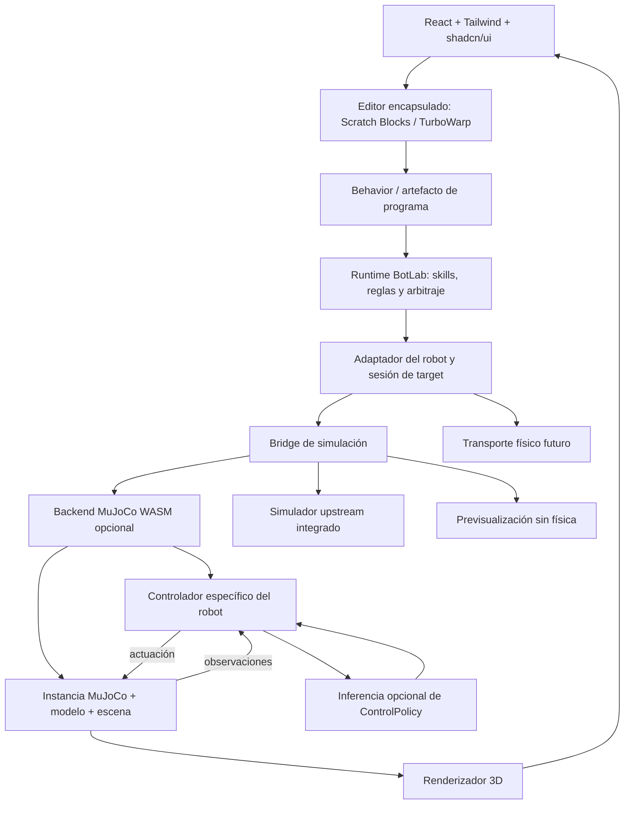

# BotLab: arquitectura de simulación web para Jumper y MicroDuck

> Implementación experimental disponible (2026-10-12): [estado medido, fases y límites](mujoco-validation.md), [arranque y reproducción](../tools/mujoco/README.md), [ADR 0003 propuesto](adr/0003-shared-browser-mujoco.md). Este documento conserva la propuesta y sus criterios; la evidencia ejecutada se registra aparte.

**Especificación de trabajo para Codex · 12 de octubre de 2026**

**Estado:** propuesta técnica original conservada como referencia. La implementación experimental y su validación actual están registradas en el [informe de resultados](mujoco-validation.md); las menciones a trabajo pendiente de este documento describen el momento de la propuesta.

Para retomar el trabajo, consultar el [registro general de próximos pasos](next-steps.md) y el [método de continuidad entre sesiones](session-workflow.md). El registro mantiene el orden vigente; este documento conserva el alcance y los criterios técnicos de la propuesta.

### Continuación de la interfaz (12 de octubre de 2026)

La gestión de proyectos pasa a un diálogo «Proyectos» con creación, apertura, nombre, duplicado, importación/exportación y eliminación con confirmación. El proyecto permanece visible al cambiar de robot. Jumper muestra un único simulador MuJoCo web; marcha es el modo habitual y las pruebas de articulaciones están en opciones avanzadas. Cada destino conserva su programa y resultados. Este ajuste continúa la integración del editor sin cambiar el motor ni las capacidades físicas validadas. La matriz de navegadores y rendimiento y la ampliación validada de movimientos siguen formando parte del plan; la evidencia ejecutada se mantiene en [mujoco-validation.md](mujoco-validation.md).

### Pruebas prolongadas y rendimiento (12 de octubre de 2026)

La ampliación de pruebas ya incluye programas importables de 190 s para Jumper y 195 s para MicroDuck, tres repeticiones físicas por robot y una medición prolongada en Chrome/M2. El reloj compartido corrige el retraso observado sin modificar los pasos físicos. El suelo incorpora una cuadrícula para apreciar el desplazamiento. Se ha documentado una limitación comprobada: MicroDuck apenas retrocede con la política actual. Los giros de Jumper, la investigación de ese retroceso y la ampliación de la matriz de dispositivos siguen pendientes; los resultados y límites se detallan en el [informe medido](mujoco-validation.md).

### Criterio educativo y siguiente incremento (12 de octubre de 2026)

BotLab es un proyecto educativo: la integración de MuJoCo debe facilitar aprender a programar, anticipar un resultado, observarlo y corregir el programa. Este criterio guía las siguientes decisiones de interfaz y capacidades, según el [plan general](implementation-plan.md#educational-product-criteria--2026-10-12).

La primera adaptación educativa está implementada: avance por pasos o metros y espera en ambos robots, giro a la izquierda en MicroDuck y comparación entre objetivo y resultado observado. «Marchar» está en la categoría Avanzado y se conservan los programas existentes. Cada robot expone solo movimientos validados en la paleta sencilla: el giro a la derecha de MicroDuck desde reposo, el retroceso y los giros de Jumper siguen pendientes. La aceptación comprueba la relación entre el bloque ejecutado, el movimiento observado y el resultado, además de estabilidad y rendimiento; véase el [informe de validación](mujoco-validation.md). Los siguientes incrementos educativos deben introducir repetición acotada y actividades de predecir, ejecutar y corregir, con semántica de ejecución comprobada.

## 1. Objetivo y alcance

Ampliar BotLab para programar robots mediante bloques, ejecutar skills y behaviors y, cuando exista una integración compatible, probarlos en simulación. Mantener **React + TypeScript + Tailwind + shadcn/ui**, con **TurboWarp detrás de la frontera del editor**, adaptadores por robot y un runtime de BotLab independiente de los motores de física.

Evaluar **MuJoCo WebAssembly como motor compartido preferente y opcional**. Jumper, del repositorio [KingKongRobotics/jumper](https://github.com/KingKongRobotics/jumper), será el primer caso de esta evaluación. **MicroDuck será el segundo robot objetivo, con una integración web sobre el mismo backend en P6.** Sus vías existentes —simulador upstream en iframe e integración nativa— se conservarán como alternativas independientes y referencias de comparación. StackChan podrá utilizar una previsualización de expresiones y movimientos sin física.

El objetivo de producto para Jumper y MicroDuck es ejecutar física, control, inferencia y visualización localmente en el navegador, sin requerir un servicio nativo local o remoto durante la ejecución del target web. La preparación de modelos, compilación y entrenamiento pueden realizarse fuera del navegador. Cada integración debe validar su combinación de robot, modelo, controlador, policy y dispositivo antes de habilitar capacidades. **No se considera demostrada la ejecución completa de Jumper en BotLab ni la disponibilidad de una policy utilizable.** Un modelo visible, un controlador compilado o una exportación ONNX no demuestran por sí solos locomoción funcional.

Este documento especifica trabajo futuro. Para redactarlo se inspeccionaron archivos locales y fuentes públicas; no se ejecutaron MuJoCo, los pesos de Jumper, su controlador ni pruebas de navegador. Los enlaces upstream apuntan a ramas/documentación mutables. La primera fase deberá fijar commits, versiones y hashes antes de realizar afirmaciones de compatibilidad reproducibles.

### Fuera de la primera entrega

- Entrenar policies desde la interfaz de BotLab.
- Conectar motores reales o desplegar controladores en hardware.
- Garantizar compatibilidad de todos los robots o navegadores.
- Sustituir automáticamente el simulador de MicroDuck.
- Importar y ejecutar paquetes arbitrarios de terceros.
- Simular varios robots simultáneamente dentro del mismo mundo.

## 2. Punto de partida de BotLab

La copia local inspeccionada contiene un monorepo Nx con estas fronteras:

| Área existente              | Situación observada                                              | Implicación para esta propuesta                                          |
| --------------------------- | ---------------------------------------------------------------- | ------------------------------------------------------------------------ |
| `apps/botlab-web`           | Aplicación React/Vite y flujo de interfaz con XState v5          | Ampliar la composición existente                                         |
| `libs/ui`                   | Tailwind y primitivas de estilo shadcn/ui                        | Reutilizar componentes y patrones visuales                               |
| `libs/blocks`               | Integración inicial de `scratch-blocks`                          | TurboWarp es un objetivo de integración, no una dependencia ya operativa |
| `libs/botlab-model`         | `Policy`, `Skill`, `Behavior`, capacidades, targets y artefactos | Extender el lenguaje sin duplicarlo                                      |
| `libs/runtime`              | Sesiones, evaluación de reglas, despacho e introspección         | Mantener la orquestación fuera de los simuladores                        |
| `libs/adapters/microduck`   | Manifiesto inicial y capacidades de ejemplo                      | No tomar los placeholders como especificaciones del hardware             |
| `libs/adapters/stackchan`   | Adaptador marcado `planned`                                      | Mantener esa condición hasta validar capacidades                         |
| `libs/simulators/core`      | Contrato ligero `SimulatorBridge`                                | Añadir soporte continuo sin introducir dependencias pesadas              |
| `libs/simulators/microduck` | Bridge de demostración que comprueba/lista comandos              | Su resultado `passed` no constituye una simulación física                |

Referencias locales que Codex debe releer en el checkout donde vaya a implementar:

- `AGENTS.md`: los archivos sincronizados bajo `sources/` son material de solo lectura.
- `docs/adr/0001-architecture-boundaries.md`: fronteras entre editor, runtime, adaptadores y simuladores.
- `docs/adr/0002-microduck-simulator-upstream-bridge.md`: integración upstream fijada, manifiestos, caché y carga diferida de MicroDuck.
- `docs/implementation-plan.md` y `docs/glossary.md`.
- `libs/botlab-model/src/lib/botlab-model.ts`.
- `libs/simulators/core/src/lib/simulators.ts`.
- `libs/simulators/microduck/src/lib/microduck-simulator.ts`.
- `apps/botlab-web/src/app/botlab-flow-machine.ts`.

Esta propuesta conserva el ADR 0001. Para admitir un motor compartido entre integraciones, proponer un nuevo ADR que amplíe el 0002: las dependencias genéricas de MuJoCo podrán residir en un paquete opcional propio; el bridge de MicroDuck seguirá siendo una integración independiente. No declarar aceptado ese ADR por el mero hecho de crear el archivo.

**Colisión de vocabulario:** actualmente `Policy` significa reglas de seguridad, recursos y ejecución. Mantener ese significado. Usar `ControlPolicy` o `LearnedPolicy` para un modelo que produce acciones del robot. No reutilizar `Skill.policyIds` para referenciar pesos neuronales.

## 3. Evidencia disponible y cuestiones abiertas

“Observado en fuente” significa que el archivo o la documentación lo contienen; no significa que se haya ejecutado aquí.

| Elemento              | Observado en fuente                                                                                                                  | Pendiente                                                                   |
| --------------------- | ------------------------------------------------------------------------------------------------------------------------------------ | --------------------------------------------------------------------------- |
| MuJoCo web            | Existen bindings oficiales JavaScript/TypeScript y paquete `@mujoco/mujoco`; la documentación distingue builds de uno y varios hilos | Fijar versión, comprobar API necesaria y validarla con BotLab/Jumper        |
| Jumper                | Upstream lo describe como robot de 22 grados de libertad                                                                             | Validar la configuración y el conjunto de articulaciones de cada tarea      |
| Modelo Jumper         | Existe `assets/jumper/jumper.xml`, con geometría, articulaciones, sensores y referencias a mallas                                    | Resolver todos sus recursos y construir la escena/control completos         |
| Entrenamiento Jumper  | El proyecto declara dependencias Python, PyTorch, MuJoCo, MuJoCo Warp y ONNX Runtime                                                 | No son un runtime directamente trasladable al navegador                     |
| Exportación           | `scripts/export.py` genera `actor.onnx` y `layout.json` y contiene comprobaciones de dimensiones y contrato                          | Obtener un checkpoint concreto y verificar sus resultados                   |
| Controlador           | `deploy/fsm` documenta un controlador Rust con destinos para navegador, Python y placa                                               | Comprobar un build concreto, su procedencia y su integración                |
| Paquetes              | Se documenta el formato `.app`, con modelos y metadatos de ejecución                                                                 | No se han descargado ni probado sus pesos o binarios en este trabajo        |
| MicroDuck / StackChan | Hay contratos y decisiones locales de BotLab                                                                                         | Identificar revisiones upstream y comprobar capacidades reales por separado |

Fuentes de las filas anteriores: [bindings oficiales de MuJoCo](https://github.com/google-deepmind/mujoco/blob/main/wasm/README.md), [presentación de Jumper](https://github.com/KingKongRobotics/jumper/blob/main/README.md), [modelo XML](https://github.com/KingKongRobotics/jumper/blob/main/assets/jumper/jumper.xml), [dependencias](https://github.com/KingKongRobotics/jumper/blob/main/pyproject.toml), [exportador](https://github.com/KingKongRobotics/jumper/blob/main/scripts/export.py), [controlador](https://github.com/KingKongRobotics/jumper/blob/main/deploy/fsm/README.md) y [formato de paquetes](https://github.com/KingKongRobotics/jumper/blob/main/deploy/BUNDLE.md).

Dos límites concretos de esta evidencia:

1. El XML de Jumper inspeccionado usa `timestep="0.001"` e `implicitfast`, pero no contiene una sección `<actuator>`. El atributo de límite de fuerza de una articulación no crea un actuador. No basta con cargar ese archivo y escribir acciones en `ctrl`: hay que identificar cómo la tarea upstream añade actuadores, escena y dinámica de servos. [Modelo de Jumper](https://github.com/KingKongRobotics/jumper/blob/main/assets/jumper/jumper.xml).
2. El cargador de prueba `tests/web/load_bundle.mjs` corre en Node y parte de sus recorridos responde con acciones de ceros. Es evidencia útil del protocolo del controlador, no una demostración de inferencia ONNX más física y renderizado en un navegador. [Prueba de carga upstream](https://github.com/KingKongRobotics/jumper/blob/main/tests/web/load_bundle.mjs).

## 4. Decisión arquitectónica propuesta

Separar cuatro responsabilidades: **programación de comportamientos**, **adaptación del robot**, **control** y **simulación**.



El diagrama muestra responsabilidades; no exige ejecutar cada caja en un proceso distinto. Un simulador upstream puede encapsular física, controlador y renderizado. BotLab no debe ejecutar un segundo lazo de control encima del que ya sea dueño de ese target.

### Invariantes

- `@botlab/model`, `@botlab/runtime` y `@botlab/simulators-core` no importan MuJoCo, ONNX, Three.js ni internals de TurboWarp.
- MuJoCo se carga cuando se selecciona un target que lo requiere. BotLab debe arrancar, editar y ejecutar targets compatibles sin descargarlo.
- Compartir motor significa reutilizar implementación, carga de recursos y herramientas. **Cada sesión conserva su propio estado de modelo, controlador e inferencia.**
- Cada robot puede tener varios targets: simulador compartido, simulador upstream y hardware, con capacidades diferentes.
- Una skill se ofrece cuando el target puede implementarla. No deducir `walk` de que el robot tenga articulaciones o un archivo MJCF.
- Renderizar una animación, simular física y ejecutar una policy son niveles distintos de soporte.
- Entrenamiento e inferencia son etapas separadas. El entrenamiento puede realizarse fuera de BotLab; eso no obliga a mantener un servicio durante la ejecución web.
- Un servicio nativo o remoto es una alternativa futura y explícita. No convertirlo silenciosamente en requisito de la experiencia local.

## 5. Skills, behaviors, policies y emociones

| Concepto              | Responsabilidad                                                | Ejemplo propuesto                                              |
| --------------------- | -------------------------------------------------------------- | -------------------------------------------------------------- |
| Capability            | Operación disponible, con parámetros, unidades y restricciones | `motion.velocity`, `joint.position`, `expression.set`          |
| Skill                 | Acción reutilizable con inicio, progreso, fin y cancelación    | “avanzar durante un tiempo”, “mirar a la izquierda”            |
| Behavior              | Programa que combina skills, eventos y condiciones             | “saludar y después explorar”                                   |
| `Policy` existente    | Reglas de autorización y límites de ejecución                  | Impedir dos sesiones compitiendo por las mismas articulaciones |
| `ControlPolicy` nueva | Artefacto de control aprendido con contrato de entrada/salida  | Una red para locomoción de una configuración de Jumper         |
| Controller            | Construye observaciones, decide acciones y aplica su semántica | Control de postura o controlador upstream más inferencia       |
| Emotion / expresión   | Intención expresiva opcional que se traduce a skills           | “curioso” puede cambiar ojos, cabeza o postura                 |
| Adapter               | Publica capacidades y conecta comandos con el target elegido   | La misma intención se traduce de forma distinta por robot      |
| Simulation backend    | Evoluciona un mundo físico cuando es necesario                 | MuJoCo WASM                                                    |

Las emociones no deben modificar directamente pesos, torques ni constantes físicas. Una emoción se traduce a una combinación permitida de skills. Si un target no dispone de expresión visual, se indica la incompatibilidad o se utiliza una alternativa declarada.

Ejemplos de portabilidad:

- Un behavior de saludo puede funcionar en StackChan mediante una expresión y en otro robot mediante un gesto, si ambos adaptadores declaran esa skill con semántica compatible.
- Una policy de Jumper no se reutiliza en MicroDuck por compartir MuJoCo: cambian morfología, observaciones, actuadores y entrenamiento.
- Un controlador sencillo de articulaciones no necesita una red neuronal.

## 6. Estructura de implementación

Extender el monorepo existente. Los directorios nuevos de esta tabla son propuestas, no archivos ya creados.

| Paquete/directorio                                      | Trabajo propuesto                                                                                                     |
| ------------------------------------------------------- | --------------------------------------------------------------------------------------------------------------------- |
| `libs/botlab-model`                                     | Descriptores de controladores/policies, evidencia de compatibilidad y referencias de recursos                         |
| `libs/runtime`                                          | Resolver skills, cancelar ejecuciones, gestionar posesión de capacidades y registrar trazas                           |
| `libs/blocks`                                           | Bloques generados por capacidades y proveedor TurboWarp cuando corresponda                                            |
| `libs/simulators/core`                                  | Contratos ligeros de sesiones continuas, snapshots y diagnóstico                                                      |
| **Nuevo:** `libs/simulators/mujoco`                     | Cargador WASM, worker, mundo físico, adaptación al render y ciclo de vida                                             |
| **Nuevo:** `libs/adapters/jumper`                       | Manifiesto de Jumper, targets y mapeo de comandos del dominio                                                         |
| **Nuevo:** `libs/simulators/jumper`                     | Composición de escena, recursos, articulaciones y controlador de Jumper                                               |
| **Nuevo, cuando se necesite:** `libs/policies/onnx-web` | Host de inferencia ONNX desacoplado de Jumper y de MuJoCo                                                             |
| `libs/simulators/microduck`                             | Conservar el bridge upstream e implementar en P6 un target independiente de MicroDuck sobre el backend web compartido |
| `libs/adapters/stackchan`                               | Evolucionar capacidades sin imponer una dependencia física                                                            |
| `apps/botlab-web` / `libs/ui`                           | Selector de robot/target, visor, controles y diagnósticos comprensibles                                               |

Crear nuevas librerías con las convenciones Nx del repositorio. Evitar extraer un sistema universal de plugins antes de completar el primer caso. Empezar con un registro tipado y explícito de factories.

La dependencia debe fluir desde las implementaciones hacia los contratos. Los registros de composición pueden conocer implementaciones concretas; la interfaz de usuario consume sus descriptores y fachadas, sin acceder a transportes, buffers WASM ni objetos del editor.

## 7. Contratos mínimos que debe concretar Codex

Son contratos de BotLab propuestos, no nombres de APIs garantizados por MuJoCo o Jumper.

| Contrato              | Contenido mínimo                                                                                            |
| --------------------- | ----------------------------------------------------------------------------------------------------------- |
| `RobotDescriptor`     | Identidad, variante, capacidades candidatas, targets y referencias de modelos                               |
| `TargetCompatibility` | Robot + backend + controlador + policy + versiones; estado y evidencia de cada combinación                  |
| `SimulationSession`   | Cargar, iniciar, pausar, avanzar un paso, reiniciar, detener, observar y liberar                            |
| `RobotController`     | Inicializar desde un contrato, aceptar intención, procesar feedback, emitir actuación y reiniciar su estado |
| `PolicyRunner`        | Cargar un artefacto, validar tensores, inferir, reiniciar estado recurrente si existe y liberar recursos    |
| `CommandHandle`       | Identificador, acuse, progreso, resultado y cancelación; no confundir “aceptado” con “completado”           |
| `RobotState`          | Tiempo de simulación, nombres y valores articulares, pose de base y sensores con unidades/marcos explícitos |
| `ActuationFrame`      | Nombres de articulaciones, modo de actuación, valores y límites; semántica verificada frente al modelo      |
| `AssetManifest`       | URL/procedencia, revisión inmutable, tamaño esperado, SHA-256, tipo y licencia de cada recurso              |
| `SimulationEvidence`  | Configuración completa, escenario, comandos, semilla, métricas, errores y resultado reproducible            |

### Evolución del contrato actual

`SimulatorBridge.simulate(artifact)` cubre hoy un caso acotado de demostración. Conservarlo como fachada para simulaciones de duración finita y añadir una interfaz de sesión continua para el visor interactivo. No convertir `simulate()` en una promesa que nunca termina.

El resultado debe expresar qué se comprobó: `command-validation`, `kinematic-preview`, `physics` o `closed-loop-policy`, además de su éxito o fallo. El estado estático `available` de un manifiesto no basta para habilitar una ejecución: hacen falta recursos resueltos y negociación de capacidades completada.

### Unidades y mapeos

- Usar SI en las fronteras del dominio: metros, segundos, radianes y N·m.
- Declarar marcos de referencia y orden de cuaterniones; convertirlos una vez en cada frontera.
- Mapear articulaciones por nombre. Resolver por separado índices de `qpos`, `qvel`, sensores y actuadores.
- No asumir que `nq`, `nv`, número de articulaciones y dimensión de acción coinciden.
- Distinguir posición objetivo, velocidad objetivo y esfuerzo. No copiar una salida neuronal a `ctrl` sin verificar qué representa cada actuador.
- Registrar los límites y la procedencia de sus valores. Rechazar dimensiones incompatibles y valores no finitos.

### Manifiesto inicial de auditoría

Ejemplo ilustrativo de un formato propio de BotLab. Los `null` son verificaciones pendientes; este objeto **no debe permitir activar la integración**.

```json
{
  "schemaVersion": 1,
  "robotId": "jumper",
  "upstream": {
    "repository": "https://github.com/KingKongRobotics/jumper",
    "commit": null
  },
  "model": {
    "sourcePath": "assets/jumper/jumper.xml",
    "sha256": null,
    "sceneBundle": null
  },
  "backend": {
    "candidate": "@mujoco/mujoco",
    "version": null,
    "validation": "pending"
  },
  "controller": {
    "sourcePath": "deploy/fsm",
    "artifactSha256": null,
    "validation": "pending"
  },
  "controlPolicy": {
    "artifact": null,
    "contract": null,
    "licenseReview": "pending",
    "validation": "pending"
  }
}
```

En el manifiesto ejecutable, los recursos resueltos deben tener versiones y hashes obligatorios. La versión de un paquete de inferencia no identifica la versión de los pesos.

## 8. MuJoCo, inferencia y renderizado en el navegador

### Carga y ejecución

1. Cargar de forma diferida el backend al seleccionar el target.
2. Resolver el manifiesto y descargar/verificar recursos en una caché versionada. La primera ejecución puede necesitar red; el modo sin conexión requiere comprobar que están todos los recursos.
3. Preparar los archivos requeridos por el cargador XML, respetando rutas relativas e includes. Resolverlos a partir de un listado permitido de recursos.
4. Crear una sesión con modelo, datos, controlador y semilla propios.
5. Ejecutar física y control fuera del hilo de React, preferentemente en un worker dedicado. Evaluar primero la compilación monohilo del motor dentro de ese worker.
6. Enviar snapshots al renderizador a una cadencia limitada; no transferir a React cada subpaso físico.
7. Liberar recursos al cambiar de target o cerrar la sesión, también tras cargas fallidas.

Los bindings oficiales documentan liberación explícita de objetos WASM y requisitos de aislamiento de origen para su build multihilo. Servir los recursos WASM correctamente y comprobar la versión concreta; no asumir que cualquier ejemplo antiguo de `mujoco-wasm` utiliza la misma API. [Bindings oficiales](https://github.com/google-deepmind/mujoco/blob/main/wasm/README.md).

### Tres relojes distintos

- **Física:** paso fijo de tiempo de simulación, determinado por la configuración validada.
- **Control/inferencia:** cadencia definida por cada controlador y policy.
- **Render:** cadencia de visualización independiente, con interpolación visual cuando proceda.

`requestAnimationFrame` no debe gobernar directamente el número de decisiones del controlador. Conservar un contador de ticks de simulación; aplicar las acciones en fronteras de control conocidas. El tiempo de pared sirve para medir rendimiento y detectar bloqueos, no para alterar silenciosamente el timestep físico.

Para la primera PoC, serializar inferencias: no iniciar otra decisión mientras una anterior esté pendiente. Si el cálculo tarda demasiado, reducir la velocidad efectiva de simulación o pausar con diagnóstico. No saltar decisiones para aparentar tiempo real. Identificar cada petición con sesión, generación tras reset y tick; descartar resultados de una sesión cancelada.

Pausar la simulación al ocultarse la pestaña durante la PoC. En ejecuciones programadas, mantener separados el reloj simulado del controlador y un watchdog de tiempo real. Al reanudar, aplicar una política explícita de reinicio de entradas y estados temporales.

**Particularidad de Jumper:** su controlador usa el reloj también para reconocer gestos temporales del operador, y la guía web indica tiempo real para esa interacción. Para replay o bloques con tiempo simulado, programar también las entradas en ese reloj y documentar la adaptación. Para interacción humana, preservar la semántica temporal upstream y pausar si la simulación no puede seguirla. No mezclar ambas bases temporales en una instancia ni dar por compatible el control interactivo por haber validado un replay. [Reloj e interacción del controlador](https://github.com/KingKongRobotics/jumper/blob/main/deploy/fsm/BUNDLE_README.md).

### Inferencia opcional

Evaluar ONNX Runtime Web únicamente cuando exista un artefacto exportado y su contrato. Empezar por un proveedor de ejecución WASM para obtener una referencia web; considerar WebGPU tras validar operadores, precisión y dispositivo. La compatibilidad depende del proveedor de ejecución y del modelo concreto. [ONNX Runtime Web](https://onnxruntime.ai/docs/get-started/with-javascript/web.html).

Mantener alineadas las versiones del JavaScript del runtime y sus binarios. Comprobar rutas de workers, MIME, CSP, CORS y requisitos del despliegue, tanto en desarrollo como en la build de producción. [Despliegue de ONNX Runtime Web](https://onnxruntime.ai/docs/tutorials/web/deploy.html).

### Renderizador

Proponer Three.js o React Three Fiber como capa visual independiente. Los cuerpos y articulaciones vienen de snapshots; mover una malla no debe modificar el estado físico. Las simplificaciones visuales no pueden cambiar las colisiones del modelo validado sin crear una variante distinta.

La cámara del visor no equivale a una cámara usada como observación de una policy. Si una policy requiere imágenes, profundidad u otros sensores todavía no reproducidos, declararla incompatible hasta implementar y comprobar esos datos.

## 9. Integración de Jumper

### J0. Auditoría reproducible

Fijar un commit de Jumper y localizar:

- Modelo del robot, mallas, includes, escenas y variantes.
- Configuración de la tarea elegida y modificaciones del modelo durante su construcción.
- Actuación, dinámica de servos, límites, inicialización, sensores y frecuencias.
- Un checkpoint o paquete distribuido con procedencia y licencia identificables.
- Contrato de observaciones/acciones, preprocesado, estado interno y dependencias auxiliares.

El proyecto documenta flujos de entrenamiento y replay y separa MuJoCo nativo de MuJoCo Warp. Usar su entorno de referencia para entender la tarea elegida; no trasladar a JavaScript todo el framework de entrenamiento. [Guía del proyecto Jumper](https://github.com/KingKongRobotics/jumper/blob/main/docs/PROJECT_GUIDE.md).

**Salida:** inventario fijado, tabla de compatibilidad y lista de incógnitas. Si no hay pesos verificables, registrar ese bloqueo y continuar con modelo/física; no entrenar automáticamente como sustitución de una descarga inexistente.

### J1. Construir una escena física completa

Obtener o generar desde la configuración upstream el modelo final de ejecución: robot, suelo, actuadores, opciones y estado inicial. Registrar el procedimiento y conservar el original; no completar silenciosamente parámetros con valores inventados.

Si es necesario producir un MJCF autocontenido fuera del navegador, tratarlo como un artefacto de preparación versionado. Validar el modelo compuesto en MuJoCo nativo antes de compararlo con WASM. Una exportación XML puede no capturar callbacks, plugins o dinámica aplicada por Python: inventariarlos y reproducirlos o declarar la limitación.

La PoC debe cargar recursos, resolver articulaciones y avanzar física con un escenario mínimo. Los sensores que no participen en el primer caso pueden quedar fuera de alcance, pero deben figurar como no soportados.

### J2. Control simple de articulaciones

Implementar un controlador acotado de prueba para un target exclusivamente simulado:

- Seleccionar una articulación por nombre.
- Aplicar una referencia limitada mediante la actuación correcta.
- Observar referencia, posición, velocidad y esfuerzo.
- Reiniciar exactamente la misma condición inicial.
- Cancelar y detener la sesión sin aceptar nuevos comandos atrasados.

Usar un soporte o base fijada si hace falta para aislar la prueba, identificando esa variante de escena. Mantener una postura o ejecutar una trayectoria manual demuestra control articular; no acredita una marcha aprendida ni equilibrio en base libre.

### J3. Integrar el controlador upstream cuando sea viable

Evaluar primero reutilizar el controlador Rust/WASM de Jumper. Su documentación centraliza observación, decodificación de acciones y cambios de modo; reimplementarlo en TypeScript duplicaría una semántica que después habría que mantener y comparar. Si el binario no es utilizable, considerar una adaptación limitada con pruebas de paridad y registrar la desviación. [Controlador compartido de Jumper](https://github.com/KingKongRobotics/jumper/blob/main/deploy/fsm/README.md).

El formato `.app` documenta contratos por modo, runtime web y vectores de referencia. El host debe resolver los recursos indicados, comprobar esquemas y mapear articulaciones por nombre. La documentación advierte que algunas policies actúan sobre un subconjunto de los 22 grados de libertad. Los modelos, contratos y runtime deben tratarse como una unidad versionada. [Formato del bundle](https://github.com/KingKongRobotics/jumper/blob/main/deploy/BUNDLE.md).

El host de BotLab debe implementar el intercambio feedback → solicitud de inferencia → respuesta → objetivos articulares, respetando el protocolo de la revisión fijada. Los objetivos y ganancias emitidos aún necesitan una capa de actuación en MuJoCo. No confundir este controlador WASM con el motor físico WASM. [Guía de integración distribuida](https://github.com/KingKongRobotics/jumper/blob/main/deploy/fsm/BUNDLE_README.md).

Verificar también cómo introducir comandos desde bloques. No asumir que un método de velocidad funciona en todos los modos: algunos paquetes pueden interpretar entradas de operador mediante su propio contrato. Encapsular esa traducción y comprobar dirección, escala, liberación y parada.

### J4. Ejecutar una policy real

Seleccionar **una sola tarea de locomoción** para empezar, según los artefactos disponibles. `jumper.tripod` aparece en la guía upstream como tarea, pero ese nombre no acredita un checkpoint adecuado ni obliga a elegirla. [Guía de Jumper](https://github.com/KingKongRobotics/jumper/blob/main/docs/PROJECT_GUIDE.md).

Si se parte de un checkpoint, utilizar la exportación de su revisión compatible y comprobar nombres, tipos y dimensiones de tensores. El exportador inspeccionado incorpora normalización en ONNX y genera metadatos; verificarlo en el artefacto elegido para evitar normalizar dos veces. No aplicar una fórmula universal a policies residuales, recurrentes o con referencias temporales. [Exportador de Jumper](https://github.com/KingKongRobotics/jumper/blob/main/scripts/export.py).

Realizar verificaciones separadas:

1. **Red:** las mismas observaciones producen salidas compatibles en el runtime de referencia y en el navegador.
2. **Controlador:** el mismo feedback y comandos producen los mismos modos, observaciones y objetivos dentro de tolerancias fijadas. Reiniciar su estado después de reproducir vectores de prueba.
3. **Planta física:** la misma actuación produce una evolución razonablemente concordante a corto plazo en nativo y WASM; registrar diferencias de motor y configuración.
4. **Lazo cerrado:** el robot se sostiene, responde al comando elegido, se desplaza y se detiene según criterios medibles.

No usar una salida de ceros, una animación grabada o un controlador manual como sustituto silencioso de pesos ausentes. Si solo funciona una de esas alternativas, describir exactamente ese nivel.

### J5. Exponer skills y bloques

Capacidades candidatas, habilitadas solo cuando se verifiquen:

| Skill propuesta    | Requisito                                           | Resultado esperado                                            |
| ------------------ | --------------------------------------------------- | ------------------------------------------------------------- |
| `setJointPosition` | Control articular validado                          | Alcanzar referencia o informar timeout                        |
| `setBodyPose`      | Controlador de postura compatible                   | Seguir una pose dentro de límites                             |
| `moveAtVelocity`   | Locomoción validada y semántica de comando conocida | Mantener una intención de velocidad durante su vigencia       |
| `stopMotion`       | Estrategia de parada del controlador                | Retirar intención de movimiento y entrar en estado comprobado |
| `resetSimulation`  | Target simulado                                     | Cancelar trabajo pendiente y restaurar estado inicial         |

“Saltar”, “bailar” y “agarrar” quedan fuera del primer caso. Su aparición en upstream no las convierte automáticamente en skills disponibles en BotLab.

## 10. MicroDuck y StackChan

| Robot / vía                              | Propuesta                                                                         | Condición para habilitarla                                                                                          |
| ---------------------------------------- | --------------------------------------------------------------------------------- | ------------------------------------------------------------------------------------------------------------------- |
| Jumper + MuJoCo compartido               | Primera PoC física                                                                | Pasar las etapas correspondientes por combinación de artefactos                                                     |
| MicroDuck + simulador upstream en iframe | Conservar el ADR 0002 y la vía web existente                                      | Verificar revisión, recursos y capacidades de la referencia elegida                                                 |
| MicroDuck + integración nativa           | Conservar la alternativa existente y sus servicios locales                        | Validación específica del target nativo; independiente del objetivo web                                             |
| MicroDuck + MuJoCo WASM compartido       | Segundo robot objetivo de P6; física, control, inferencia y visor en el navegador | Artefactos propios verificados, behavior observable y cancelable, y comparación medida con una referencia existente |
| StackChan + previsualización             | Expresiones, orientación y audio según capacidades validadas                      | Semántica de cada skill y render comprobados                                                                        |
| StackChan + MuJoCo                       | Opcional si aparece una necesidad física concreta                                 | Modelo físico disponible o creado y calibrado                                                                       |
| Cualquiera + hardware                    | Target separado                                                                   | Transporte y validación física específicos                                                                          |

No inventar una URL de MicroDuck ni identificar su simulador por parecido de nombre: resolver el upstream exacto a partir del proyecto antes de integrar. Mantener separados los targets web compartido, upstream en iframe y nativo para comparar resultados y poder volver a una integración existente.

P6 forma parte del alcance planificado: MicroDuck deja de ser un segundo robot meramente opcional. Compartirá la implementación genérica del motor, la carga de recursos, los contratos de sesión y el intercambio con el visor; tendrá su propio modelo, escena, controlador, policies y mapeos. El éxito de Jumper no acredita compatibilidad de MicroDuck.

La auditoría P0 debe identificar también las revisiones, modelos, policies, control y licencias de MicroDuck, y elegir una integración existente como referencia. La implementación de su nuevo target se realizará en P6. La preparación externa de artefactos es admisible; durante la ejecución, la nueva vía deberá funcionar con los servicios nativos apagados.

Para aceptar P6, ejecutar desde bloques una secuencia de movimiento y giro con parada y cancelación observables, verificar reset y cambio entre Jumper y MicroDuck sin sesiones residuales, y comparar seguimiento y parada con la referencia elegida mediante tolerancias declaradas antes de la prueba. Registrar física, inferencia, control, rendimiento y navegadores por separado. Las capacidades adicionales, incluidos sensores y skills, se habilitarán según su propia evidencia. Si faltan artefactos o no se alcanza la compatibilidad, registrar el bloqueo y mantener P6 pendiente; conservar una integración existente no equivale a completar esta fase.

Los mundos pueden compartir una descripción de escena y convenciones de unidades, pero la compatibilidad sigue siendo explícita: contactos, escala, sensores y superficies pueden requerir adaptaciones. La validación inicial debe usar suelo plano; los terrenos complejos vienen después.

## 11. React, TurboWarp y ciclo de vida

### Interfaz

Reutilizar el sistema visual del proyecto para ofrecer:

- Selector de robot y destino: simulación, previsualización o hardware cuando exista.
- Estado de carga con causa y acción de recuperación.
- Visor y controles de reproducir, pausar, paso, reiniciar y detener.
- Lista de skills disponibles y explicación breve de las incompatibles.
- Indicador del nivel alcanzado: “Modelo cargado”, “Física activa”, “Control articular” o “Policy validada”.
- Panel de diagnóstico opcional con versiones, métricas y trazas.

No presentar todos los detalles de WASM, tensores o contratos en el flujo principal. El usuario debe entender qué puede hacer y por qué una función no está disponible.

### Editor y ejecución

Conservar `libs/blocks` como frontera. Primero conectar el caso mínimo usando el proveedor existente. Integrar TurboWarp detrás de esa misma interfaz sin convertir su VM en un segundo runtime de behaviors accidentalmente.

Decisión inicial propuesta: los bloques robóticos producen artefactos y comandos interpretados por `@botlab/runtime`. Si se necesita compatibilidad completa de ejecución Scratch, documentar qué semántica delega BotLab a la VM de TurboWarp y quién posee pausas, variables, concurrencia y cancelación. No afirmar compatibilidad completa de proyectos Scratch a partir de unos bloques personalizados.

Los bloques envían intenciones asíncronas, nunca realizan el bucle físico. La parada global debe cancelar handles, retirar entradas persistentes y liberar la posesión de capacidades. El eje de locomoción no puede estar simultáneamente controlado por un behavior y un joystick sin arbitraje explícito.

Las extensiones TurboWarp sin aislamiento tienen acceso amplio al entorno; reservar esa vía a código propio revisado. No cargar extensiones arbitrarias para resolver la PoC. [Documentación de extensiones TurboWarp](https://docs.turbowarp.org/development/extensions/unsandboxed).

### XState v5 existente

Ampliar el flujo actual conservando sus regiones y convenciones. Esquema propuesto para la sesión de simulación:

```text
idle → loading → ready → running ⇄ paused
          │        │        │        │
          └────────┴────────┴────────┴──→ error

ready/running/paused → resetting → ready
cualquier sesión activa → disposing → disposed
error → reintentar carga o liberar sesión
```

Usar actores para carga asíncrona y comunicación con el worker; la máquina coordina el ciclo de vida, no los subpasos físicos. Mantener datos duraderos en contexto y estados finitos en la máquina. Evitar booleanos paralelos que contradigan `ready`, `running` o `error`.

Cambiar de robot cancela la carga/ejecución anterior y crea una generación de sesión nueva. Al resetear, restablecer física, filtros, históricos, estado recurrente, entradas y reloj. No reentrar innecesariamente en regiones hermanas del statechart al actualizar un snapshot.

## 12. Plan de implementación y puertas de decisión

| Fase                         | Trabajo y entregable                                                                | Criterio de aceptación                                                                                                                                                                          |
| ---------------------------- | ----------------------------------------------------------------------------------- | ----------------------------------------------------------------------------------------------------------------------------------------------------------------------------------------------- |
| P0. Auditoría                | Inventario, revisiones, licencias y matriz de incógnitas                            | Se identifica qué archivos y contratos hacen falta; ausencias explícitas                                                                                                                        |
| P1. Contratos                | Nuevo ADR propuesto, targets y sesiones ligeras                                     | La app funciona sin cargar MuJoCo; demos existentes siguen diferenciadas                                                                                                                        |
| P2. Backend mínimo           | MuJoCo opcional y escena sencilla de referencia                                     | Carga, paso fijo, pausa, reset y liberación funcionan en navegador real                                                                                                                         |
| P3. Jumper físico            | Escena completa y control de una articulación                                       | Recursos resueltos, física finita y respuesta articular comprobada                                                                                                                              |
| P4. Policy                   | Artefacto concreto, inferencia y controlador                                        | Paridad y lazo cerrado medidos; o bloqueo documentado sin falso éxito                                                                                                                           |
| P5. BotLab completo          | Skill → bloque → runtime → target simulado                                          | Ejecutar y cancelar un behavior produce efecto y traza verificables                                                                                                                             |
| P6. MicroDuck web compartido | Integrar MicroDuck como segundo robot sobre el backend MuJoCo WASM usado por Jumper | Física, control, inferencia y visor en navegador sin servicio nativo; behavior observable y cancelable, comparación con referencia y cambio de robot sin lógica específica en el motor genérico |

**Orden:** P0 → P1 → P2 → P3 → P4/P5 → P6. P5 puede empezar con control articular si P4 está bloqueada por pesos o compatibilidad.

P1–P5 validan el primer recorrido con Jumper; P6 completa el objetivo de reutilización con MicroDuck. Un bloqueo de la policy de Jumper no impide iniciar P6 si el backend, el control articular y el recorrido de bloques de P3/P5 ya están validados. Un modelo sintético sirve para comprobar contratos y aislamiento, pero no sustituye la integración de MicroDuck ni permite dar P6 por completada. La sustitución de sus targets existentes requerirá una decisión posterior basada en resultados.

### Evidencia mínima de la PoC

- Registro de versiones, hashes, navegador, SO, dispositivo y configuración.
- Captura o grabación del resultado junto con trazas numéricas; la imagen sola no demuestra control.
- Escena y secuencia de comandos repetibles con semilla registrada.
- Resultado separado para modelo, física, control, inferencia y lazo cerrado.
- Informe de errores y de requisitos no satisfechos.

### Criterios medibles propuestos

Estos objetivos son criterios iniciales de BotLab, no mediciones existentes ni garantías upstream:

- **Física:** 60 segundos simulados sin NaN/Inf ni errores de recursos. Repetir desde reset con tres ejecuciones de la misma configuración.
- **Control articular:** dirección correcta, cumplimiento de límites y error final medido contra una tolerancia declarada antes de la prueba.
- **Inferencia:** conjunto fijo de observaciones de referencia; tolerancia por salida fijada antes de comparar. Como punto de partida, evaluar `abs(a-b) <= 1e-5 + 1e-4*abs(b)` para float32, ajustándolo solo con justificación documentada. Usar los umbrales upstream cuando correspondan a su verificador de controlador.
- **Locomoción:** 60 segundos simulados con mantenimiento inicial, movimiento y parada; definir previamente velocidad solicitada, altura/inclinación admisibles y criterio de caída según la tarea. Registrar distancia, error de seguimiento y fallos.
- **Rendimiento:** medir arranque frío/caliente, memoria, latencia de inferencia p50/p95, duración de pasos, frames y factor de tiempo real. Aspiración inicial: factor ≥ 1 y visualización ≥ 30 FPS en un equipo de referencia identificado. Si no se cumple, clasificar como funcional a velocidad reducida.
- **Ciclo de vida:** diez ciclos de carga/reset/cambio de target sin listeners o sesiones duplicados ni crecimiento persistente de memoria tras estabilización.
- **Parada:** acuse del runtime y retirada de comandos; comprobar que la cancelación no reaparece tras una inferencia tardía. Distinguir detener la simulación de detener el movimiento manteniendo física activa.

Validar Chromium, Firefox y Safari actuales en una matriz con versión exacta. Marcar cada combinación “probada”, “fallida” o “pendiente”; los móviles quedan inicialmente como evaluación adicional. WebGPU y multihilo son rutas opcionales, no requisitos generales de la primera PoC.

## 13. Riesgos y respuestas

| Riesgo                                      | Cómo detectarlo                                       | Respuesta                                                                                 |
| ------------------------------------------- | ----------------------------------------------------- | ----------------------------------------------------------------------------------------- |
| Falta de pesos o procedencia incierta       | Auditoría sin artefacto identificable                 | Entregar física/control articular; mantener locomoción pendiente                          |
| Modelo incompleto respecto a la tarea       | Diferencias entre XML y entorno upstream              | Exportar/componer la escena y documentar lógica externa                                   |
| Incompatibilidad de versiones MuJoCo        | Errores de carga o divergencia de corto plazo         | Fijar combinación y comparar con referencia nativa                                        |
| Actuación distinta de la usada al entrenar  | Seguimiento incorrecto aun con inferencia equivalente | Reproducir ganancias, saturación, retardos y dinámica necesaria                           |
| Observaciones o orden articular incorrectos | Falla de vectores de referencia                       | Mapeo por nombre y validación de unidades, marcos e históricos                            |
| Operadores ONNX no soportados               | Falla de carga o comparación numérica                 | Cambiar proveedor/exportación solo con nueva validación                                   |
| Worker o inferencia demasiado lentos        | Backlog, latencia elevada, factor de tiempo real bajo | Reducir velocidad visible; optimizar sin alterar silenciosamente el contrato              |
| Recursos bloqueados por despliegue          | Errores WASM/worker/CORS/CSP                          | Comprobar build servida y rutas; mantener una vía monohilo                                |
| Recursos grandes o caché obsoleta           | Descarga incompleta o hash distinto                   | Caché por versión/hash y errores recuperables                                             |
| Código ejecutable dentro de un paquete      | Importación de glue JS externo                        | Primera PoC con artefactos fijados; diseñar aislamiento antes de aceptar subidas          |
| “Simulación aprobada” engañosa              | Solo se verificaron comandos o animaciones            | Etiquetar nivel de evidencia en resultado e interfaz                                      |
| Cambios de upstream                         | Contratos o esquemas distintos                        | Actualización explícita con nuevas pruebas y posibilidad de volver a la revisión anterior |
| Transferencia a hardware                    | Éxito simulado interpretado como aptitud física       | Mantener otro target y otro proceso de validación                                         |

Un worker separa carga de trabajo, pero no debe tratarse como una frontera de confianza para JavaScript arbitrario. Si se añade importación de `.app` ajenos, aislar el código y limitar sus comunicaciones/recursos. La guía upstream propone aislamiento de la parte ejecutable del paquete. Esto es independiente de mantener el visor React integrado. [Integración web y paquetes](https://github.com/KingKongRobotics/jumper/blob/main/deploy/fsm/BUNDLE_README.md).

**Licencias:** Jumper declara Apache-2.0 para material propio, distingue material de terceros y advierte que las salidas generadas no heredan automáticamente esa licencia. Revisar por separado código, mallas, texturas, pesos, sonidos y paquetes. Fijar procedencia y conservar avisos antes de redistribuir. [Licencia y alcance declarados](https://github.com/KingKongRobotics/jumper/blob/main/README.md).

**Hardware:** la documentación de despliegue consultada mantiene pendientes la verificación de inferencia RKNN en placa y el lazo contra el bus real. Ningún resultado de esta PoC debe presentarse como validación del robot físico. [Pendientes de despliegue de Jumper](https://github.com/KingKongRobotics/jumper/blob/main/deploy/README.md#open).

## 14. Instrucción de entrega para Codex

Implementa esta propuesta por fases sobre el estado real del repositorio. Empieza por P0 y conserva las fronteras existentes. Trata los nombres de contratos nuevos como propuestas que debes reconciliar con los tipos actuales.

1. Relee instrucciones locales y ADR; no modifiques material sincronizado bajo `sources/`.
2. Registra qué afirmaciones has verificado en fuente y cuáles has ejecutado.
3. Fija upstream y artefactos antes de integrar. No inventes hashes, pesos, frecuencias, ganancias ni compatibilidad.
4. Mantén MuJoCo y ONNX opcionales, detrás de carga diferida.
5. Conserva el significado de `Policy` y añade un concepto distinto para control aprendido.
6. Entrega primero modelo/física/control articular de Jumper y después la policy, si supera sus verificaciones.
7. Integra un recorrido vertical desde un bloque hasta una acción observable y cancelable.
8. Implementa MicroDuck como segundo robot sobre el backend web compartido en P6. Conserva sus targets upstream en iframe y nativo, y la estrategia independiente de StackChan. Verifica los artefactos y las capacidades propias de MicroDuck; si hay un bloqueo, documenta la causa y mantén P6 pendiente.
9. Ejecuta las comprobaciones apropiadas de los paquetes afectados y la build web. Los scripts `affected:*` y `build:libs` existen, pero debes revisar su cobertura al añadir proyectos; el script raíz `test` no prueba automáticamente todas las librerías.
10. Actualiza documentación y referencias simbólicas de README solo cuando cambien las APIs o estructuras que describen.

La entrega de implementación debe incluir código, manifiestos reproducibles, instrucciones de arranque, un behavior de ejemplo, pruebas pertinentes, mediciones y una matriz honesta de compatibilidad. Si la policy no funciona, entregar el nivel alcanzado y el bloqueo concreto.

**Criterio de decisión final:** adoptar MuJoCo como backend compartido preferente para Jumper y MicroDuck cuando las PoC de ambos demuestren utilidad y mantenimiento razonables. Una PoC validada solo con Jumper acredita ese primer target; la reutilización entre ambas familias queda pendiente hasta completar P6. Mantener el backend opcional incluso entonces. La disponibilidad de locomoción se decide por robot, controlador y artefacto; no se hereda del nombre del motor.
